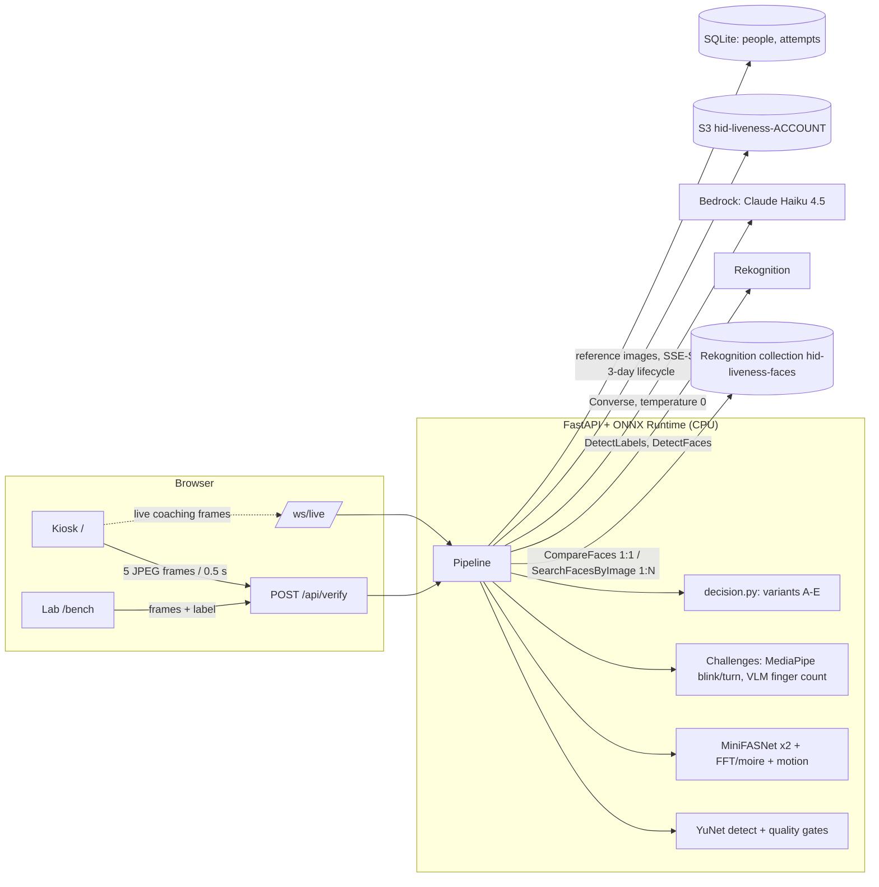

# Architecture

Face liveness + identity prototype for the HID "Can You Spot a Spoof?" challenge. One FastAPI process
runs the whole pipeline; AWS supplies identity (Rekognition), cloud liveness signals (Bedrock + Rekognition)
and storage (S3). Region: **us-east-1 only**.

## Components

`hid-gate` (a teammate's prototype, same account) is a **source of signals only**. Its Rekognition
collection `hid-gate` is never read or written by this project.

## Signals

| Signal | Where | What it contributes |
|---|---|---|
| YuNet face detection + 5 landmarks | local | face count, box, yaw/roll for quality and head-turn challenges |
| Quality gates | local | sharpness (Laplacian), brightness, face size, pose -> step-up, never a hard DENY |
| MiniFASNet V2 (2.7x) + V1SE (4.0x) | local ONNX | passive anti-spoof score (re-capture artifacts), mean over frames |
| FFT/moire cue | local | high-frequency peak energy (screens); uncalibrated until Phase 3 |
| Landmark motion cue | local | non-rigid motion across the 5 frames |
| CompareFaces / SearchFacesByImage | Rekognition | identity similarity (claim-ID 1:1 / open-set 1:N) |
| **VLM liveness** (from hid-gate) | Bedrock Converse | `live` 0..1, attack type, <=10-word evidence; strict JSON |
| **DetectLabels** (from hid-gate) | Rekognition | phone/tablet/monitor/TV boxes; "face centre inside a device box"; weak hints (paper, mask, poster) |
| **DetectFaces extras** (from hid-gate) | Rekognition | FACE_OCCLUDED, brightness, sharpness: a second quality opinion |
| Active challenges | local + Bedrock | blink, turn left/right (MediaPipe/YuNet), finger count 1-5 (VLM + CompareFaces same-person) |

## Variants (all re-decidable offline from stored raw signals)

| Variant | Rule |
|---|---|
| A | MiniFASNet only |
| B | A minus a moire penalty |
| C | B minus a motion penalty |
| D | hid-gate's rules as ported: VLM + devices + Rekognition face quality + identity; local signals ignored |
| E | **fused, fail closed**: DENY if VLM live <= 0.30, a device is over the face, local liveness (B) < T_lo, or identity < T_match_lo. ALLOW only if local >= T_hi AND VLM >= 0.75 AND no device AND similarity >= T_match. Otherwise step-up. A VLM or DetectLabels timeout / parse failure never yields ALLOW |

The kiosk's variant is `kiosk.variant` in `config.yaml` (provisionally **E**; to be set to the variant that
wins on held-out data). Lab attempts always collect every signal, so variants are compared on identical attempts.

## Latency budget (target: capture end -> decision on screen <= 2000 ms)

Network signals start together once the sharpest frame is picked (~65 ms) and run in parallel with local work.
Measured on a laptop over home internet to us-east-1, one sample face (indicative, not eval numbers):

| Stage | Warm p50 | Notes |
|---|---|---|
| Decode + detect + quality (5 frames) | ~65 ms | |
| MiniFASNet + cues (5 frames) | ~30-60 ms | runs while the network calls are in flight |
| CompareFaces | 330-600 ms | first call after start/enrol ~2 s; kept warm with a real CompareFaces |
| DetectLabels | ~450-570 ms | |
| DetectFaces | ~330-450 ms | |
| Bedrock VLM (Haiku 4.5) | ~950-1200 ms | critical path for D/E; cold ~2.6 s, ~1.4 s after a text warm-up |
| Server total, variant E | ~0.97-1.03 s | |
| Capture end -> shown, variant E (bench) | ~1.0 s | |
| Capture end -> shown, variant A | ~0.46-0.69 s | |

**Fail closed under the budget:** cloud signals are collected until `cloud.budget_ms` (1400 ms after launch).
Anything unfinished is recorded as `timeout`; variants D/E then step up instead of allowing. Keep-warm loops
hold the Rekognition (real CompareFaces) and Bedrock (text Converse) connections open while idle.

## Privacy (summary; expanded in Phase 5)

- Enrollment requires explicit consent; a person can be deleted (DB row, Rekognition face, S3 images).
- Reference images: S3, SSE-S3 encrypted, HTTPS-only bucket policy, 3-day lifecycle expiry.
- Failed enrollments store no images. Frames sent to Bedrock/Rekognition are processed in memory.
- Attempt thumbnails (96 px) and optional eval frames stay under `data/` and `eval_data/` (git-ignored).
